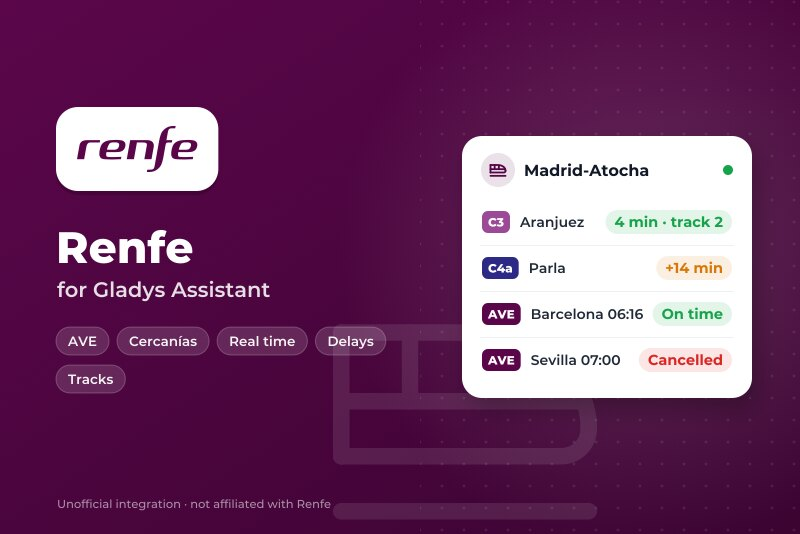
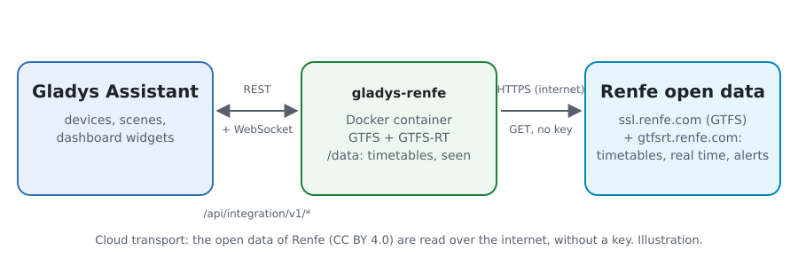
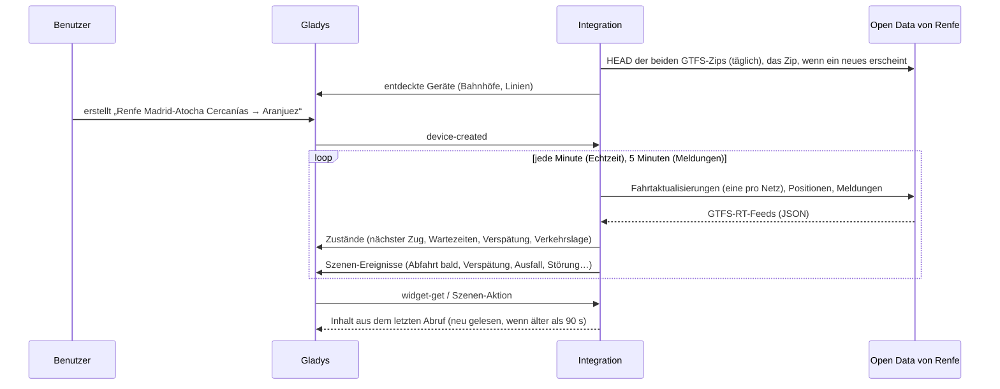
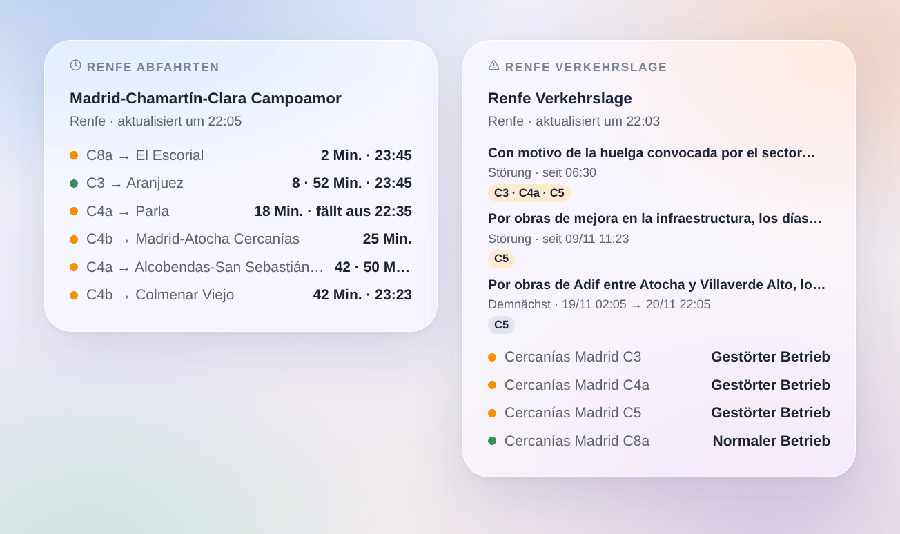

# Gladys Renfe

[English](README.md) · [Français](README.fr.md) · **Deutsch** · [Español](README.es.md)

[](LICENSE)
[](https://github.com/William-De71/gladys-renfe/releases)
[](https://github.com/William-De71/gladys-renfe/actions/workflows/release.yml)
[](https://gladysassistant.com)



Externe Integration für [Gladys Assistant](https://gladysassistant.com) für die **Renfe**, die spanischen Züge — Fern- und Regionalverkehr (AVE, Avlo, Alvia, Intercity, Regional) sowie die Cercanías und Rodalies jedes Núcleo: die nächsten Züge an deinen Bahnhöfen, in Echtzeit korrigiert, mit Verspätung, Gleis, Ankunft an deinem Ziel und den ausgefallenen Zügen, und die Verkehrslage deiner Cercanías-Linien, mit Szenen und Dashboard-Widgets. Sie liest die offiziellen Open Data von Renfe (GTFS und GTFS-RT), ohne Konto und ohne Schlüssel.

Benutzerdokumentation: [English](docs/en.md) · [Français](docs/fr.md) · [Deutsch](docs/de.md) · [Español](docs/es.md).

> Community-Integration, weder mit Renfe noch mit Adif verbunden noch von ihnen unterstützt.

## Funktionen

- **Ein Gerät pro verfolgtem Bahnhof** (drei im Formular, bis zu 10 weitere über die Schaltfläche **Bahnhof hinzufügen**), per Name oder Code eingegeben, bei Bedarf in Richtung eines **Zielbahnhofs** und für eine **Linie** (eine Cercanías-Linie oder ein Fernverkehrsprodukt): nächster Zug, Wartezeit der nächsten zwei Züge, Verspätung des nächsten, sein Gleis und seine Ankunftszeit.
- **Ein Gerät pro verfolgter Cercanías-Linie** (bis zu sechs): ihr Betriebszustand (normal, Verkehrsinformation, gestört, stark gestört) aus den Meldungen von Renfe und die laufenden Meldungen.
- **Echtzeit**: die erwartete Zeit und die Verspätung, sobald der Zug seinen Startbahnhof verlassen hat, sonst der Fahrplan (als solcher markiert), die ausgefallenen Züge und die nicht bedienten Bahnhöfe, das Gleis der Cercanías-Züge.
- **6 Szenen-Auslöser** (darunter ein Zug mit 5 bis 60 Minuten Verspätung), **2 Szenen-Aktionen** und **2 Dashboard-Widgets** (siehe unten).
- **Eine Anfrage pro Netz für alle verfolgten Bahnhöfe**: die Echtzeit standardmäßig jede Minute (30 s bis 5 min, nachts alle 10 min, wenn nichts angekündigt ist), die Meldungen alle 5 Minuten, die beiden Fahrpläne einmal am Tag und nur, wenn sie sich geändert haben (in `/data` gespeichert).
- Konfigurationsschaltflächen: Verbindung testen, Bahnhof suchen (Codes, Linien), Bahnhöfe hinzufügen / entfernen / auflisten, Diagnose.
- Überall vier Sprachen: Englisch, Französisch, Deutsch, Spanisch.

## Funktionsweise



```mermaid
flowchart LR
  G[Gladys Assistant] <-->|REST /api/integration/v1/* + WebSocket| I[Container gladys-renfe]
  I -->|HTTPS, ohne Schlüssel| A[ssl.renfe.com (GTFS)<br/>gtfsrt.renfe.com (GTFS-RT, JSON)]
  I --- D[(/data<br/>Fahrplan-Zips, Linien, Bahnhöfe, gesehene Ereignisse)]
```

Beim Start lädt die Integration die beiden Fahrpläne von Renfe herunter (das Zip des Fernverkehrs, 0,7 MB, und das der Cercanías, 15 MB) und speichert sie in `/data`; an den folgenden Tagen vergleicht eine HEAD-Anfrage ihre Größe und ihr Datum (die Server von Renfe datieren dieselbe Datei um Sekunden verschieden), und ein Zip wird nur neu geladen, wenn Renfe ein neues veröffentlicht hat. Sie liest die Linien (`routes.txt`: die Fernverkehrsprodukte „AVE“, „Regional“; die Cercanías-Linien jedes Núcleo, die IDs „10T0007C3“ beider Richtungen zu „C3 Madrid“ zusammengefasst) und die Bahnhöfe beider Dateien, zusammengeführt über die Codes von Adif („17000“ für Madrid-Chamartín-Clara Campoamor). Dann löst sie deine Eingaben auf: „chamartin“ ist der Bahnhof 17000, „C3“ die C3, die deinen Bahnhof bedient. Aus den Zips entnimmt sie die Halte der verfolgten Bahnhöfe über acht Tage (`trips.txt` und `stop_times.txt`, entpackt 272 MB für die Cercanías, werden als Stream gelesen, nie im Speicher gehalten: ein Lesevorgang erreicht etwa 170 MB und dauert einige Sekunden). Mit eigenem Timer liest sie die Fahrtaktualisierungen der Netze deiner Bahnhöfe (eine JSON-Anfrage pro Netz, unabhängig von der Zahl der Bahnhöfe) und die Positionen der Cercanías-Züge (ihr Gleis); Renfe kündigt die Verspätung am nächsten Bahnhof jedes Zuges an, übertragen auf deinen Bahnhof. Alle 5 Minuten liest sie die Meldungen. Jeder Abruf wird mit dem vorherigen verglichen, um die Szenen-Auslöser auszulösen.



### Transport

Nur Cloud (`"transports": ["cloud"]`): Der Katalog zeigt das Cloud-Abzeichen. Die Integration kontaktiert `ssl.renfe.com` + `gtfsrt.renfe.com`. Es gibt keine lokale Alternative, daher keine Schaltfläche „lokale Verbindung bevorzugen“.

## Geräte und Funktionen

| Gerät                        | Funktion                           | Kategorie / Typ              | Werte                                                              |
| ---------------------------- | ---------------------------------- | ---------------------------- | ------------------------------------------------------------------ |
| Renfe \<Bahnhof\> → \<Ziel\> | Nächster Zug                       | `text` / `text`              | „C3 → Aranjuez · 3 Min. (+2 Min. Verspätung) · Gleis 2 · an 23:13“ |
| Renfe \<Bahnhof\> → \<Ziel\> | Wartezeit, Wartezeit des Folgenden | `duration` / `integer`       | 0 … 180 Min.                                                       |
| Renfe \<Bahnhof\> → \<Ziel\> | Verspätung des nächsten Zuges      | `duration` / `integer`       | 0 … 300 Min.                                                       |
| Renfe Cercanías \<Linie\>    | Verkehrslage                       | `text` / `text`              | „Gestörter Betrieb: Por obras de mejora en la infraestructura…“    |
| Renfe Cercanías \<Linie\>    | Aktuelle Verkehrsmeldungen         | `counter-sensor` / `integer` | 0 … 20                                                             |

Ohne Zug in den nächsten vier Stunden zeigt der Bahnhof den ersten Zug jeder Fahrt in den nächsten 24 Stunden; die Verspätung wird nur für einen in Echtzeit verfolgten Zug veröffentlicht.

## Szenen-Auslöser, Aktionen und Widgets



**Szenen-Auslöser** (einmal pro Übergang; der erste Abruf dient als Referenz und löst nichts aus):

- **Abfahrt bald**: ein Zug eines verfolgten Bahnhofs fährt in 2, 3, 5, 10, 15, 20 oder 30 Minuten ab, nach seiner Echtzeitprognose. Filter: Bahnhof, Minuten.
- **Zug verspätet**: ein Zug eines verfolgten Bahnhofs, der in den nächsten zwei Stunden abfährt, hat 5, 10, 15, 30 oder 60 Minuten Verspätung oder mehr, einmal pro Zug und Schwelle. Filter: Bahnhof, Minuten.
- **Zug fällt aus**: ein Zug eines verfolgten Bahnhofs, der in den nächsten zwei Stunden abfährt, fällt aus oder hält dort nicht mehr. Filter: Bahnhof.
- **Linie gestört**: eine verfolgte Linie wird gestört oder stark gestört. Filter: Linie.
- **Wieder normal**: keine laufende Störung mehr auf der Linie. Filter: Linie.
- **Neue Verkehrsmeldung**: Renfe veröffentlicht eine Meldung zu einer verfolgten Linie, laufend oder demnächst. Filter: Linie, Art (Information, Störung, starke Störung).

**Szenen-Aktionen**: **nächste Züge** eines Bahnhofs (Linie, Zugnummer, Ziel, Wartezeit, Zeit, Ankunft, Gleis, Echtzeit oder nicht, Verspätung, der folgende, ein Satz) und **Verkehrslage einer Linie** (Zustand, Meldungen, letzte Meldung, ein Satz).

**Widgets**: **Renfe Abfahrten** (ein verfolgter Bahnhof, mehrere in einer Liste oder ein beliebiger in den Einstellungen eingegebener Bahnhof) und **Renfe Verkehrslage** (die verfolgten Linien, die eingegebenen oder standardmäßig die Cercanías-Linien deiner Bahnhöfe).

Beispiele:

- Wenn **deine C3 nach Aranjuez in 10 Minuten abfährt** → die Flurlampe grün schalten.
- Wenn **dein AVE nach Barcelona 15 Minuten Verspätung hat** oder **ausfällt** → `{{triggerEvent.data.summary}}` ans Handy schicken.
- Jeden Werktag um 7:30 → **die nächsten Züge lesen** und die `summary` vom Küchenlautsprecher sprechen lassen.

## Voraussetzungen

- Gladys Assistant **5.3.0** oder neuer (Widgets und Szenen-Auslöser externer Integrationen, Katalog-Schlüsselwörter und Länder von Gladys 5.3). Ältere Instanzen können die Integration nicht installieren.
- Sonst nichts: Die Open Data von Renfe brauchen weder Konto noch Schlüssel.

## Installation

- **Aus dem Store** von Gladys (Integrationen → Externe Integrationen), mit einem Klick, sobald indexiert.
- **Über die URL des Repositorys**: `https://github.com/William-De71/gladys-renfe`.
- **Entwicklermodus**: das Image lokal bauen (`docker build -t gladys-renfe .`) und in Gladys installieren.

## Konfiguration

| Feld               | Beschreibung                                                                                         |
| ------------------ | ---------------------------------------------------------------------------------------------------- |
| Bahnhof (1 bis 3)  | Ein Name, wie Renfe ihn schreibt, ein Teil davon oder sein Code: „Madrid-Atocha Cercanías“, „17000“. |
| Ziel               | Nur die Züge, die dort danach halten: „Aranjuez“. Leer: alle abfahrenden Züge.                       |
| Linie              | „C3“, „R2N“, „AVE“, „Regional“. Leer: alle Linien.                                                   |
| Verfolgte Linien   | Cercanías-Linien, bis zu sechs, bei Bedarf mit Núcleo: „C3 Madrid, C1 Sevilla“.                      |
| Abruf der Echtzeit | 30 s, 1 min (Standard), 2 min oder 5 min.                                                            |
| Sprache der Texte  | Gerätenamen, Zusammenfassungen und Ausgaben der Szenen.                                              |

Schaltflächen: **Verbindung testen**, **Bahnhof suchen** (Code und Linien jedes gefundenen Bahnhofs), **Bahnhof hinzufügen**, **Bahnhof entfernen**, **Bahnhöfe auflisten** (die Bahnhöfe über die drei des Formulars hinaus, in der Gladys-Konfiguration gespeichert) und **Diagnose** (schreibt Bahnhöfe, Linien, gespeicherte Fahrpläne, letzte Züge, Fehler und Anfragen in den Tab Protokolle).

## Verwendung

1. Gib einen bis drei Bahnhöfe ein — mehr mit **Bahnhof hinzufügen** — (auf Wunsch mit Ziel und Linie) und die zu verfolgenden Cercanías-Linien, dann speichern.
2. Im Tab **Entdecken** die Geräte „Renfe …“ erstellen.
3. Die Widgets **Renfe Abfahrten** und **Renfe Verkehrslage** zu einem Dashboard hinzufügen und Szenen mit den Auslösern oben bauen.

## Entwicklung

```bash
npm install
npm test                       # node --test, berührt nie das Netzwerk
npm run lint && npm run format:check
npx github:GladysAssistant/integration-store . --skip-image-check
scripts/build-cover.sh         # cover.jpg aus docs/assets/cover.svg
docs/illustrations/render.sh   # docs/assets/widgets.<Sprache>.png
node .github/scripts/release.mjs next
```

Lokal liest das SDK `GLADYS_HOST_API_URL`, `GLADYS_INTEGRATION_TOKEN` und `GLADYS_INTEGRATION_SELECTOR`; `RENFE_API_URL`, `RENFE_GTFS_LD_URL` und `RENFE_GTFS_CER_URL` lenken die Integration auf andere Quellen (eine Attrappe); `DEBUG=gladys-integration-sdk` zeigt die SDK-Logs und prüft jeden Widget-Inhalt. Die Tests nutzen echte, reduzierte Open Data von Renfe (`test/fixtures/`, CC BY 4.0, der Abend des 17. November 2026): Die Zips baut `test/helpers/fixtures.js`. Die Regeln des Projekts stehen in [CLAUDE.md](CLAUDE.md).

## Release-Prozess


Jeder Merge auf `main` startet die CI und berechnet dann die Version aus den [Conventional Commits](https://www.conventionalcommits.org/de/) seit dem letzten Tag: `feat` → Minor, `fix` / `perf` → Patch, `!` oder `BREAKING CHANGE` → Major (unter 1.0.0 ein Minor); `docs`, `chore`, `ci`, `test`, `style`, `refactor`, `build` allein veröffentlichen nichts. Der Changelog-Abschnitt wird erzeugt, der Tag gepusht, das Multi-Architektur-Image gebaut, dann erhält `main` den Release-Commit, die GitHub Release wird erstellt und ein letzter Job prüft das öffentliche Image, den Store-Validator und das Topic.

- Der Titel des Pull Requests wird zum Squash-Commit und dann zur Changelog-Zeile: auf Englisch, für den Benutzer schreiben (`pr-title.yml` prüft ihn). `CHANGELOG.md` nie von Hand bearbeiten.
- 1.0.0 ist eine Entscheidung: Actions → Release → Run workflow mit `release-as: 1.0.0`. `dry-run` zeigt Version und Notizen ohne Veröffentlichung.
- **Geschützter Branch**: Die Release pusht ihren Commit mit `GITHUB_TOKEN` auf `main`. Bei einem Ruleset auf `main`, das strenger ist als „kein Löschen, kein Force-Push“, GitHub Actions zur Bypass-Liste hinzufügen (oder über eine GitHub App pushen), sonst schlägt der Veröffentlichungsjob mit Anweisungen fehl.
- Nach der ersten Release das Paket auf `ghcr.io` öffentlich machen (Package settings → Change visibility), sonst kann Gladys es nicht laden.

## Fehlerbehebung

Siehe [docs/de.md](docs/de.md#fehlerbehebung). Probleme bitte mit den Versionen von Gladys und der Integration, dem betroffenen Bahnhof oder der Linie und den Zeilen der Schaltfläche **Diagnose** melden.

## Mitwirken

Issues und Pull Requests sind willkommen. Vor einem Pull Request `npm run format:check && npm run lint && npm test` ausführen und alle externen IDs und gespeicherten Schlüssel unverändert lassen (siehe [CLAUDE.md](CLAUDE.md)).

## Sicherheit

Siehe [SECURITY.md](SECURITY.md): Schwachstellen bitte privat melden. Die Integration braucht kein Geheimnis: Sie liest nur öffentliche Open Data und läuft schreibgeschützt, als Nicht-Root-Benutzer, in ihrem Container.

## Kommende Screenshots

Die Bilder oben sind Illustrationen, keine Screenshots. Echte Screenshots kommen in `docs/assets/screenshots/` (PNG, 1280 × 800): `configuration.png`, `discovery.png`, `device.png`, `scene.png`.

## Lizenz

[Apache License 2.0](LICENSE) — siehe auch [NOTICE](NOTICE). Die Fahrpläne, die Echtzeit und die Meldungen sind Open Data von Renfe (data.renfe.com) unter der Lizenz [Creative Commons Namensnennung 4.0](https://creativecommons.org/licenses/by/4.0/deed.de): Die Widgets zeigen die Quelle und die Zeit jedes Abrufs. Danke an die Dokumentation und das SDK von Gladys und an Renfe für die Veröffentlichung dieser Daten in Echtzeit.
