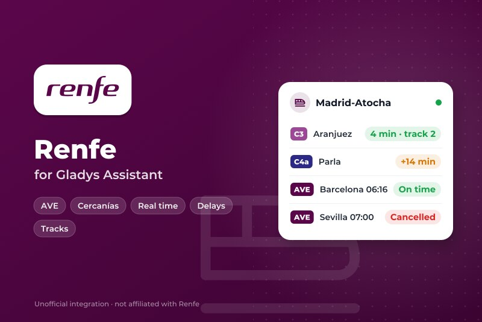
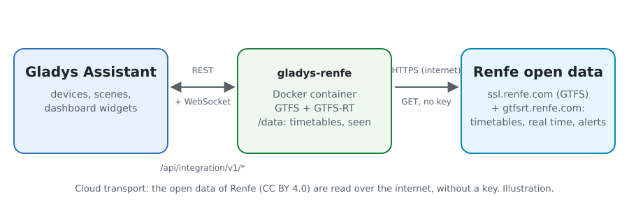
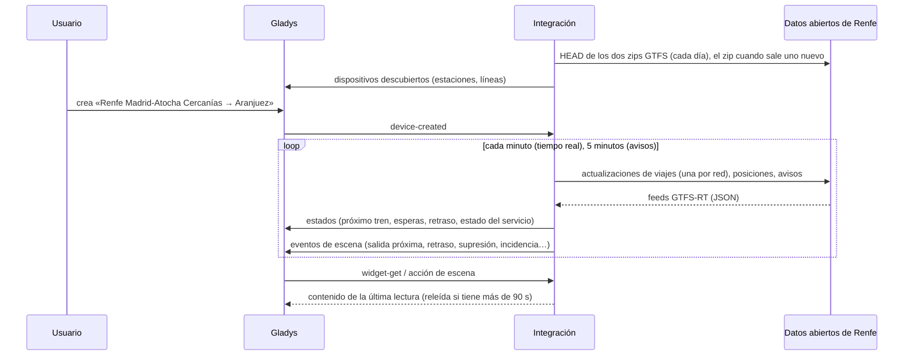
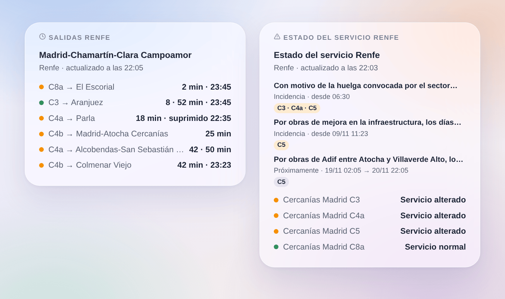

# Gladys Renfe

[English](README.md) · [Français](README.fr.md) · [Deutsch](README.de.md) · **Español**

[](LICENSE)
[](https://github.com/William-De71/gladys-renfe/releases)
[](https://github.com/William-De71/gladys-renfe/actions/workflows/release.yml)
[](https://gladysassistant.com)



Integración externa de [Gladys Assistant](https://gladysassistant.com) para **Renfe** — larga y media distancia (AVE, Avlo, Alvia, Intercity, Regional) y las Cercanías y Rodalies de cada núcleo: los próximos trenes en tus estaciones, corregidos en tiempo real, con su retraso, su vía, su llegada a tu destino y los trenes suprimidos, y el estado de tus líneas de Cercanías, con escenas y widgets de panel. Lee los datos abiertos oficiales de Renfe (GTFS y GTFS-RT), sin cuenta ni clave.

Documentación de usuario: [English](docs/en.md) · [Français](docs/fr.md) · [Deutsch](docs/de.md) · [Español](docs/es.md).

> Integración comunitaria, sin relación con Renfe ni con Adif ni respaldada por ellas.

## Funciones

- **Un dispositivo por estación seguida** (tres en el formulario, hasta 10 más con el botón **Añadir una estación**), escrita por nombre o código, si quieres hacia una **estación de destino** y para una **línea** (una línea de Cercanías o un producto de larga distancia): próximo tren, espera de los dos próximos trenes, retraso del próximo, su vía y su hora de llegada.
- **Un dispositivo por línea de Cercanías seguida** (hasta seis): su estado (normal, aviso, alterado, muy alterado) según los avisos de Renfe, y los avisos en curso.
- **Tiempo real**: la hora estimada y el retraso en cuanto el tren sale de su estación de origen, el horario teórico si no (marcado como tal), los trenes suprimidos y las estaciones sin parada, la vía de los trenes de Cercanías.
- **6 disparadores de escena** (entre ellos un tren con 5 a 60 minutos de retraso), **2 acciones de escena** y **2 widgets** de panel (abajo).
- **Una petición por red para todas las estaciones seguidas**: el tiempo real cada minuto por defecto (30 s a 5 min, cada 10 min de noche cuando no se anuncia nada), los avisos cada 5 minutos, los dos horarios una vez al día y solo si cambiaron (guardados en `/data`).
- Botones de configuración: probar la conexión, buscar una estación (códigos, líneas), añadir / quitar / listar estaciones, diagnóstico.
- Cuatro idiomas en todo: inglés, francés, alemán, español.

## Funcionamiento



```mermaid
flowchart LR
  G[Gladys Assistant] <-->|REST /api/integration/v1/* + WebSocket| I[contenedor gladys-renfe]
  I -->|HTTPS, sin clave| A[ssl.renfe.com (GTFS)<br/>gtfsrt.renfe.com (GTFS-RT, JSON)]
  I --- D[(/data<br/>zips de horarios, líneas, estaciones, eventos vistos)]
```

Al arrancar, la integración descarga los dos horarios de Renfe (el zip de larga distancia, 0,7 MB, y el de Cercanías, 15 MB) y los guarda en `/data`; los días siguientes una petición HEAD compara su tamaño y su fecha (los servidores de Renfe fechan un mismo archivo con segundos de diferencia), y un zip solo se vuelve a descargar cuando Renfe publica uno nuevo. Lee las líneas (`routes.txt`: los productos de larga distancia, «AVE», «Regional»; las líneas de Cercanías de cada núcleo, los identificadores «10T0007C3» de ambos sentidos reunidos en «C3 Madrid») y las estaciones de los dos archivos, unidas por los códigos de Adif («17000» para Madrid-Chamartín-Clara Campoamor). Luego resuelve lo que escribiste: «chamartin» es la estación 17000, «C3» la C3 que pasa por tu estación. De los zips extrae las paradas de las estaciones seguidas durante ocho días (`trips.txt` y `stop_times.txt`, 272 MB descomprimidos en Cercanías, se leen en flujo, nunca enteros en memoria: una lectura llega a unos 170 MB y tarda unos segundos). Con su propio temporizador lee las actualizaciones de viajes de las redes de tus estaciones (una petición JSON por red, sea cual sea el número de estaciones) y las posiciones de los trenes de Cercanías (su vía); Renfe anuncia el retraso en la próxima estación de cada tren, que se traslada a tu estación. Cada 5 minutos lee los avisos. Cada lectura se compara con la anterior para lanzar los disparadores de escena.



### Transporte

Solo cloud (`"transports": ["cloud"]`): el catálogo muestra la insignia cloud. La integración contacta con `ssl.renfe.com` + `gtfsrt.renfe.com`. No hay alternativa local, así que no hay botón «preferir la conexión local».

## Dispositivos y funciones

| Dispositivo                    | Función                      | Categoría / tipo             | Valores                                                             |
| ------------------------------ | ---------------------------- | ---------------------------- | ------------------------------------------------------------------- |
| Renfe \<estación\> → \<dest.\> | Próximo tren                 | `text` / `text`              | «C3 → Aranjuez · 3 min (+2 min de retraso) · vía 2 · llegada 23:13» |
| Renfe \<estación\> → \<dest.\> | Espera, espera del siguiente | `duration` / `integer`       | 0 … 180 min                                                         |
| Renfe \<estación\> → \<dest.\> | Retraso del próximo tren     | `duration` / `integer`       | 0 … 300 min                                                         |
| Renfe Cercanías \<línea\>      | Estado del servicio          | `text` / `text`              | «Servicio alterado: Por obras de mejora en la infraestructura…»     |
| Renfe Cercanías \<línea\>      | Avisos en curso              | `counter-sensor` / `integer` | 0 … 20                                                              |

Sin tren en las próximas cuatro horas, la estación muestra el primer tren de cada trayecto de las 24 horas siguientes; el retraso solo se publica para un tren seguido en tiempo real.

## Disparadores, acciones y widgets



**Disparadores de escena** (una vez por transición; la primera lectura es una referencia y no dispara nada):

- **Salida próxima**: un tren de una estación seguida sale dentro de 2, 3, 5, 10, 15, 20 o 30 minutos, según su estimación en tiempo real. Filtros: estación, minutos.
- **Tren con retraso**: un tren de una estación seguida que sale en las próximas dos horas lleva 5, 10, 15, 30 o 60 minutos de retraso o más, una vez por tren y umbral. Filtros: estación, minutos.
- **Tren suprimido**: un tren de una estación seguida que sale en las próximas dos horas está suprimido o ya no para allí. Filtro: estación.
- **Línea alterada**: una línea seguida pasa a alterada o muy alterada. Filtro: línea.
- **Fin de la incidencia**: ya no hay ninguna incidencia en curso en la línea. Filtro: línea.
- **Nuevo aviso**: Renfe publica un aviso sobre una línea seguida, en curso o próximo. Filtros: línea, tipo (información, incidencia, incidencia grave).

**Acciones de escena**: **próximos trenes** de una estación (línea, número de tren, destino, espera, hora, llegada, vía, tiempo real o no, retraso, el siguiente, una frase) y **estado de una línea** (estado, avisos, último aviso, una frase).

**Widgets**: **Salidas Renfe** (una estación seguida, varias en una lista, o cualquier estación escrita en los ajustes) y **Estado del servicio Renfe** (las líneas seguidas, las escritas, o por defecto las líneas de Cercanías de tus estaciones).

Ejemplos:

- Cuando **tu C3 a Aranjuez sale dentro de 10 minutos** → encender en verde la lámpara de la entrada.
- Cuando **tu AVE a Barcelona lleva 15 minutos de retraso** o **está suprimido** → enviar `{{triggerEvent.data.summary}}` al móvil.
- Cada día laborable a las 7:30 → **leer los próximos trenes** de tu estación y que el altavoz de la cocina diga el `summary`.

## Requisitos

- Gladys Assistant **5.3.0** o posterior (widgets y disparadores de escena de las integraciones externas, palabras clave y países del catálogo de Gladys 5.3). Las instancias anteriores no pueden instalar la integración.
- Nada más: los datos abiertos de Renfe no piden cuenta ni clave.

## Instalación

- **Desde el store** de Gladys (Integraciones → Integraciones externas), con un clic, una vez indexada.
- **Desde la URL del repositorio**: `https://github.com/William-De71/gladys-renfe`.
- **Modo desarrollador**: construye la imagen en local (`docker build -t gladys-renfe .`) e instálala desde Gladys.

## Configuración

| Campo                   | Descripción                                                                                     |
| ----------------------- | ----------------------------------------------------------------------------------------------- |
| Estación (1 a 3)        | Un nombre tal como lo escribe Renfe, una parte o su código: «Madrid-Atocha Cercanías», «17000». |
| Destino                 | Solo los trenes que paran allí después: «Aranjuez». Vacío: todos los trenes que salen.          |
| Línea                   | «C3», «R2N», «AVE», «Regional». Vacío: todas las líneas.                                        |
| Líneas seguidas         | Líneas de Cercanías, hasta seis, con su núcleo si hace falta: «C3 Madrid, C1 Sevilla».          |
| Lectura del tiempo real | 30 s, 1 min (por defecto), 2 min o 5 min.                                                       |
| Idioma de los textos    | Nombres de los dispositivos, resúmenes y salidas de las escenas.                                |

Botones: **Probar la conexión**, **Buscar una estación** (código y líneas de cada estación encontrada), **Añadir una estación**, **Quitar una estación**, **Listar las estaciones** (las estaciones más allá de las tres del formulario, guardadas en la configuración de Gladys) y **Diagnóstico** (escribe en la pestaña Registros las estaciones, líneas, horarios guardados, últimos trenes, errores y peticiones).

## Uso

1. Escribe de una a tres estaciones — más con **Añadir una estación** — (con destino y línea si quieres) y las líneas de Cercanías que seguir, y guarda.
2. En la pestaña **Descubrir**, crea los dispositivos «Renfe …».
3. Añade los widgets **Salidas Renfe** y **Estado del servicio Renfe** a un panel, y crea escenas con los disparadores de arriba.

## Desarrollo

```bash
npm install
npm test                       # node --test, nunca toca la red
npm run lint && npm run format:check
npx github:GladysAssistant/integration-store . --skip-image-check
scripts/build-cover.sh         # cover.jpg desde docs/assets/cover.svg
docs/illustrations/render.sh   # docs/assets/widgets.<idioma>.png
node .github/scripts/release.mjs next
```

En local, el SDK lee `GLADYS_HOST_API_URL`, `GLADYS_INTEGRATION_TOKEN` y `GLADYS_INTEGRATION_SELECTOR`; `RENFE_API_URL`, `RENFE_GTFS_LD_URL` y `RENFE_GTFS_CER_URL` dirigen la integración hacia otras fuentes (un simulador); `DEBUG=gladys-integration-sdk` muestra los registros del SDK y comprueba cada contenido de widget. Las pruebas usan datos abiertos reales de Renfe, reducidos (`test/fixtures/`, CC BY 4.0, la tarde del 17 de noviembre de 2026): los zips los construye `test/helpers/fixtures.js`. Las reglas del proyecto están en [CLAUDE.md](CLAUDE.md).

## Proceso de publicación


Cada fusión en `main` lanza la CI y luego calcula la versión a partir de los [Conventional Commits](https://www.conventionalcommits.org/es/) desde la última etiqueta: `feat` → menor, `fix` / `perf` → parche, `!` o `BREAKING CHANGE` → mayor (una menor por debajo de 1.0.0); `docs`, `chore`, `ci`, `test`, `style`, `refactor`, `build` solos no publican nada. Se genera la sección del changelog, se envía la etiqueta, se construye la imagen multiarquitectura, luego `main` recibe el commit de publicación, se crea la GitHub Release y un último job comprueba la imagen pública, el validador del store y el topic.

- El título de la pull request se convierte en el commit squash y luego en la línea del changelog: escríbelo en inglés, para el usuario (`pr-title.yml` lo comprueba). No edites nunca `CHANGELOG.md` a mano.
- La 1.0.0 es una decisión: Actions → Release → Run workflow con `release-as: 1.0.0`. `dry-run` muestra la versión y las notas sin publicar.
- **Rama protegida**: la publicación envía su commit a `main` con `GITHUB_TOKEN`. Con un ruleset en `main` más estricto que «sin borrado, sin force-push», añade GitHub Actions a su lista de excepciones (o envía mediante una GitHub App); si no, el job de publicación falla con instrucciones.
- Tras la primera publicación, haz público el paquete de `ghcr.io` (Package settings → Change visibility); si no, Gladys no puede descargarlo.

## Solución de problemas

Ver [docs/es.md](docs/es.md#solución-de-problemas). Informa de los problemas con las versiones de Gladys y de la integración, la estación o la línea afectada, y las líneas del botón **Diagnóstico**.

## Contribuir

Issues y pull requests son bienvenidas. Ejecuta `npm run format:check && npm run lint && npm test` antes de abrir una pull request, y no cambies ningún identificador externo ni clave guardada (ver [CLAUDE.md](CLAUDE.md)).

## Seguridad

Ver [SECURITY.md](SECURITY.md): informa de las vulnerabilidades en privado. La integración no necesita ningún secreto: solo lee datos abiertos públicos y se ejecuta en solo lectura, como usuario no root, en su contenedor.

## Capturas próximamente

Las imágenes de arriba son ilustraciones, no capturas. Las capturas reales irán en `docs/assets/screenshots/` (PNG, 1280 × 800): `configuration.png`, `discovery.png`, `device.png`, `scene.png`.

## Licencia

[Licencia Apache 2.0](LICENSE) — ver también [NOTICE](NOTICE). Los horarios, el tiempo real y los avisos son datos abiertos de Renfe (data.renfe.com) con licencia [Creative Commons Reconocimiento 4.0](https://creativecommons.org/licenses/by/4.0/deed.es): los widgets muestran la fuente y la hora de cada lectura. Gracias a la documentación y al SDK de Gladys, y a Renfe por publicar estos datos en tiempo real.
