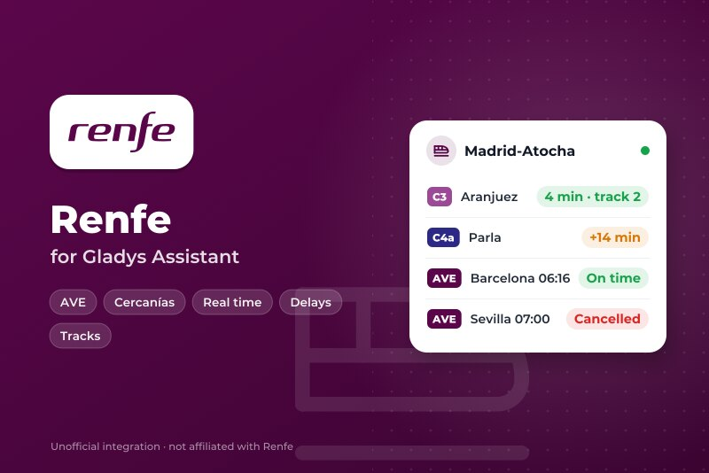
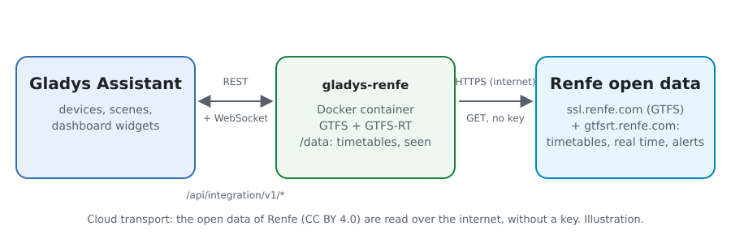
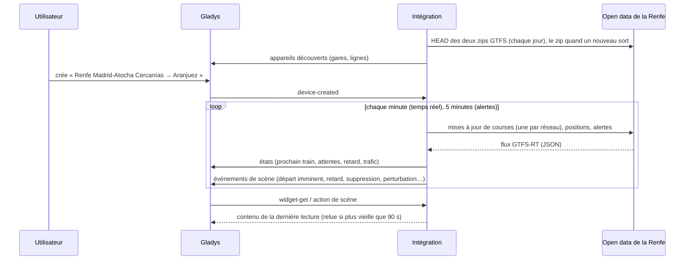
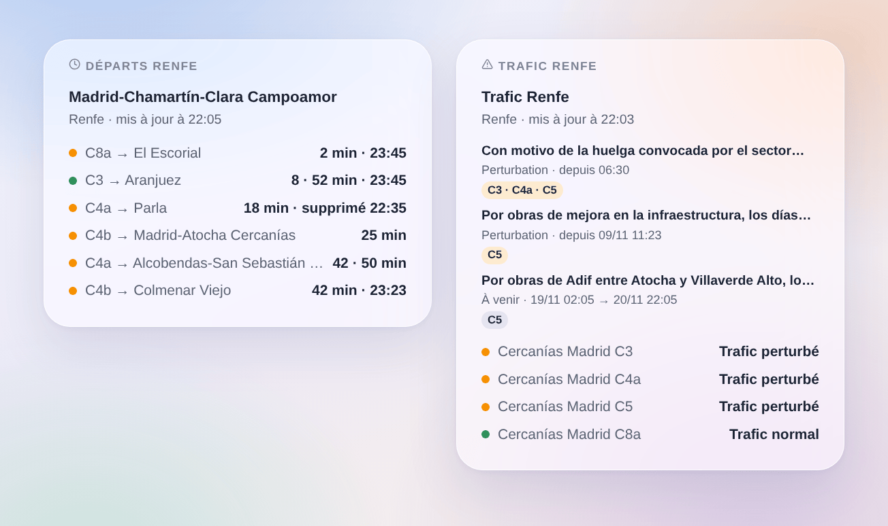

# Gladys Renfe

[English](README.md) · **Français** · [Deutsch](README.de.md) · [Español](README.es.md)

[](LICENSE)
[](https://github.com/William-De71/gladys-renfe/releases)
[](https://github.com/William-De71/gladys-renfe/actions/workflows/release.yml)
[](https://gladysassistant.com)



Intégration externe de [Gladys Assistant](https://gladysassistant.com) pour la **Renfe**, les trains espagnols — grandes lignes (AVE, Avlo, Alvia, Intercity, Regional) et Cercanías et Rodalies de chaque núcleo : les prochains trains dans vos gares, corrigés en temps réel, avec leur retard, leur voie, leur arrivée à votre destination et les trains supprimés, et le trafic de vos lignes de Cercanías, avec scènes et widgets de tableau de bord. Elle lit l’open data officiel de la Renfe (GTFS et GTFS-RT), sans compte ni clé.

Documentation utilisateur : [English](docs/en.md) · [Français](docs/fr.md) · [Deutsch](docs/de.md) · [Español](docs/es.md).

> Intégration communautaire, ni affiliée à la Renfe ou à Adif, ni approuvée par elles.

## Fonctionnalités

- **Un appareil par gare suivie** (trois dans le formulaire, jusqu’à 10 de plus avec le bouton **Ajouter une gare**), saisie par nom ou par code, au besoin vers une **gare de destination** et pour une **ligne** (une ligne de Cercanías ou un produit grandes lignes) : prochain train, attente des deux prochains trains, retard du prochain, sa voie et son heure d’arrivée.
- **Un appareil par ligne de Cercanías suivie** (six au plus) : son état de trafic (normal, info trafic, perturbé, très perturbé) d’après les alertes de la Renfe, et les messages en cours.
- **Temps réel** : l’heure estimée et le retard dès que le train a quitté sa gare d’origine, l’horaire théorique sinon (signalé comme tel), les trains supprimés et les gares non desservies, la voie des trains de Cercanías.
- **6 déclencheurs de scène** (dont un train en retard de 5 à 60 minutes), **2 actions de scène** et **2 widgets** de tableau de bord (ci-dessous).
- **Une requête par réseau pour toutes les gares suivies** : le temps réel chaque minute par défaut (30 s à 5 min, toutes les 10 min la nuit quand rien n’est annoncé), les alertes toutes les 5 minutes, les deux horaires une fois par jour, seulement s’ils ont changé (gardés dans `/data`).
- Boutons de configuration : tester la connexion, chercher une gare (codes, lignes), ajouter / retirer / lister les gares, diagnostic.
- Quatre langues partout : anglais, français, allemand, espagnol.

## Fonctionnement



```mermaid
flowchart LR
  G[Gladys Assistant] <-->|REST /api/integration/v1/* + WebSocket| I[conteneur gladys-renfe]
  I -->|HTTPS, sans clé| A[ssl.renfe.com (GTFS)<br/>gtfsrt.renfe.com (GTFS-RT, JSON)]
  I --- D[(/data<br/>zips des horaires, lignes, gares, événements vus)]
```

Au démarrage, l’intégration télécharge les deux horaires de la Renfe (le zip des grandes lignes, 0,7 Mo, et celui des Cercanías, 15 Mo) et les garde dans `/data` ; les jours suivants, une requête HEAD compare leur taille et leur date (les serveurs de la Renfe datent un même fichier à quelques secondes près), et un zip n’est retéléchargé que si la Renfe en a publié un nouveau. Elle lit les lignes (`routes.txt` : les produits grandes lignes, « AVE », « Regional » ; les lignes de Cercanías de chaque núcleo, les identifiants « 10T0007C3 » des deux sens réunis en « C3 Madrid ») et les gares des deux fichiers, fusionnées sur les codes d’Adif (« 17000 » pour Madrid-Chamartín-Clara Campoamor). Elle résout ensuite ce que vous avez saisi : « chamartin » est la gare 17000, « C3 » la C3 qui dessert votre gare. Elle extrait des zips les passages des gares suivies sur huit jours (`trips.txt` et `stop_times.txt`, 272 Mo décompressés pour les Cercanías, sont lus en flux, jamais gardés en mémoire : une lecture culmine vers 170 Mo et prend quelques secondes). Sur sa propre minuterie, elle lit les mises à jour de courses des réseaux de vos gares (une requête JSON par réseau, quel que soit le nombre de gares) et les positions des trains de Cercanías (leur voie) ; la Renfe annonce le retard à la prochaine gare de chaque train, reporté à votre gare. Toutes les 5 minutes, elle lit les alertes. Chaque lecture est comparée à la précédente pour déclencher les scènes.



### Transport

Cloud uniquement (`"transports": ["cloud"]`) : le catalogue affiche le badge cloud. L’intégration contacte `ssl.renfe.com` + `gtfsrt.renfe.com`. Il n’existe pas d’alternative locale, donc pas de bouton « préférer la connexion locale ».

## Appareils et fonctionnalités

| Appareil                   | Fonctionnalité              | Catégorie / type             | Valeurs                                                            |
| -------------------------- | --------------------------- | ---------------------------- | ------------------------------------------------------------------ |
| Renfe \<gare\> → \<dest.\> | Prochain train              | `text` / `text`              | « C3 → Aranjuez · 3 min (+2 min de retard) · voie 2 · arr. 23:13 » |
| Renfe \<gare\> → \<dest.\> | Attente, attente du suivant | `duration` / `integer`       | 0 … 180 min                                                        |
| Renfe \<gare\> → \<dest.\> | Retard du prochain train    | `duration` / `integer`       | 0 … 300 min                                                        |
| Renfe Cercanías \<ligne\>  | Trafic                      | `text` / `text`              | « Trafic perturbé : Por obras de mejora en la infraestructura… »   |
| Renfe Cercanías \<ligne\>  | Infos trafic en cours       | `counter-sensor` / `integer` | 0 … 20                                                             |

Sans train dans les quatre heures, la gare affiche le premier train de chaque trajet des 24 heures suivantes ; le retard n’est publié que pour un train suivi en temps réel.

## Déclencheurs, actions et widgets



**Déclencheurs de scène** (une fois par transition ; la première lecture sert de référence et ne déclenche rien) :

- **Départ imminent** : un train d’une gare suivie part dans 2, 3, 5, 10, 15, 20 ou 30 minutes, sur son estimation en temps réel. Filtres : gare, minutes.
- **Train en retard** : un train d’une gare suivie partant dans les deux heures a 5, 10, 15, 30 ou 60 minutes de retard ou plus, une fois par train et par seuil. Filtres : gare, minutes.
- **Train supprimé** : un train d’une gare suivie partant dans les deux heures est supprimé ou ne s’y arrête plus. Filtre : gare.
- **Ligne perturbée** : une ligne suivie devient perturbée ou très perturbée. Filtre : ligne.
- **Fin de perturbation** : plus aucune perturbation en cours sur la ligne. Filtre : ligne.
- **Nouveau message trafic** : la Renfe publie une alerte sur une ligne suivie, en cours ou à venir. Filtres : ligne, nature (information, perturbation, forte perturbation).

**Actions de scène** : **prochains trains** d’une gare (ligne, numéro du train, destination, attente, heure, arrivée, voie, temps réel ou non, retard, le suivant, une phrase) et **trafic d’une ligne** (état, messages, dernier message, une phrase).

**Widgets** : **Départs Renfe** (une gare suivie, plusieurs dans une liste, ou n’importe quelle gare saisie dans les réglages) et **Trafic Renfe** (les lignes suivies, celles saisies, ou par défaut les lignes de Cercanías de vos gares).

Exemples :

- Quand **votre C3 vers Aranjuez part dans 10 minutes** → allumer la lampe de l’entrée en vert.
- Quand **votre AVE pour Barcelone a 15 minutes de retard** ou **est supprimé** → envoyer `{{triggerEvent.data.summary}}` sur votre téléphone.
- Chaque jour de semaine à 7 h 30 → **lire les prochains trains** de votre gare et faire dire le `summary` par l’enceinte de la cuisine.

## Prérequis

- Gladys Assistant **5.3.0** ou plus récent (widgets et déclencheurs de scène des intégrations externes, mots-clés et pays du catalogue de Gladys 5.3). Les instances plus anciennes ne peuvent pas installer l’intégration.
- Rien d’autre : l’open data de la Renfe ne demande ni compte ni clé.

## Installation

- **Depuis le store** de Gladys (Intégrations → Intégrations externes), en un clic, une fois indexée.
- **Depuis l’URL du dépôt** : `https://github.com/William-De71/gladys-renfe`.
- **Mode développeur** : construisez l’image en local (`docker build -t gladys-renfe .`) et installez-la depuis Gladys.

## Configuration

| Champ                 | Description                                                                                       |
| --------------------- | ------------------------------------------------------------------------------------------------- |
| Gare (1 à 3)          | Un nom tel que la Renfe l’écrit, une partie ou son code : « Madrid-Atocha Cercanías », « 17000 ». |
| Destination           | Seulement les trains qui la desservent ensuite : « Aranjuez ». Vide : tous les trains au départ.  |
| Ligne                 | « C3 », « R2N », « AVE », « Regional ». Vide : toutes les lignes.                                 |
| Lignes suivies        | Lignes de Cercanías, six au plus, avec leur núcleo si besoin : « C3 Madrid, C1 Sevilla ».         |
| Lecture du temps réel | 30 s, 1 min (par défaut), 2 min ou 5 min.                                                         |
| Langue des textes     | Noms des appareils, résumés et sorties des scènes.                                                |

Boutons : **Tester la connexion**, **Chercher une gare** (code et lignes de chaque gare trouvée), **Ajouter une gare**, **Retirer une gare**, **Lister les gares** (les gares au-delà des trois du formulaire, gardées dans la configuration de Gladys) et **Diagnostic** (écrit dans l’onglet Journaux les gares, lignes, horaires gardés, derniers trains, erreurs et requêtes).

## Utilisation

1. Saisissez une à trois gares — davantage avec **Ajouter une gare** — (avec une destination et une ligne si vous voulez) et les lignes de Cercanías à suivre, puis enregistrez.
2. Dans l’onglet **Découvrir**, créez les appareils « Renfe … ».
3. Ajoutez les widgets **Départs Renfe** et **Trafic Renfe** à un tableau de bord, et créez des scènes avec les déclencheurs ci-dessus.

## Développement

```bash
npm install
npm test                       # node --test, ne touche jamais le réseau
npm run lint && npm run format:check
npx github:GladysAssistant/integration-store . --skip-image-check
scripts/build-cover.sh         # cover.jpg depuis docs/assets/cover.svg
docs/illustrations/render.sh   # docs/assets/widgets.<langue>.png
node .github/scripts/release.mjs next
```

En local, le SDK lit `GLADYS_HOST_API_URL`, `GLADYS_INTEGRATION_TOKEN` et `GLADYS_INTEGRATION_SELECTOR` ; `RENFE_API_URL`, `RENFE_GTFS_LD_URL` et `RENFE_GTFS_CER_URL` dirigent l’intégration vers d’autres sources (un simulateur) ; `DEBUG=gladys-integration-sdk` affiche les journaux du SDK et vérifie chaque contenu de widget. Les tests utilisent de vraies données ouvertes de la Renfe, réduites (`test/fixtures/`, CC BY 4.0, le soir du 17 novembre 2026) : les zips sont construits par `test/helpers/fixtures.js`. Les règles du projet sont dans [CLAUDE.md](CLAUDE.md).

## Processus de release


Chaque fusion sur `main` lance la CI, puis calcule la version à partir des [Conventional Commits](https://www.conventionalcommits.org/fr/) depuis le dernier tag : `feat` → mineure, `fix` / `perf` → correctif, `!` ou `BREAKING CHANGE` → majeure (une mineure sous la 1.0.0) ; `docs`, `chore`, `ci`, `test`, `style`, `refactor`, `build` seuls ne publient rien. La section du changelog est générée, le tag poussé, l’image multi-architecture construite, puis `main` reçoit le commit de release, la GitHub Release est créée et un dernier job vérifie l’image publique, le validateur du store et le topic.

- Le titre de la pull request devient le commit squash, puis la ligne du changelog : écrivez-le en anglais, pour l’utilisateur (`pr-title.yml` le vérifie). Ne modifiez jamais `CHANGELOG.md` à la main.
- La 1.0.0 est une décision : Actions → Release → Run workflow avec `release-as: 1.0.0`. `dry-run` montre la version et les notes sans publier.
- **Branche protégée** : des rulesets imposent une pull request sur `main` et verrouillent les tags `v*` ; seuls le mainteneur et les deploy keys passent. La release pousse avec la deploy key de l’environnement `release` (secret `RELEASE_DEPLOY_KEY`, `main` seulement) : un run lancé depuis une autre branche ne l’obtient jamais. `build.yml` et `github-release.yml` ne démarrent pas sur un tag : la release les appelle, ou lancez-les à la main (Actions → Run workflow, avec `version` pour l’image) pour terminer une release.
- Après la première release, rendez public le paquet `ghcr.io` (Package settings → Change visibility), sinon Gladys ne peut pas le récupérer.

## Dépannage

Voir [docs/fr.md](docs/fr.md#dépannage). Signalez les problèmes avec les versions de Gladys et de l’intégration, la gare ou la ligne concernée, et les lignes du bouton **Diagnostic**.

## Contribuer

Issues et pull requests bienvenues. Lancez `npm run format:check && npm run lint && npm test` avant d’ouvrir une pull request, et gardez inchangés tous les identifiants externes et clés stockées (voir [CLAUDE.md](CLAUDE.md)).

## Sécurité

Voir [SECURITY.md](SECURITY.md) : signalez les vulnérabilités en privé. L’intégration n’a besoin d’aucun secret : elle ne lit que des données publiques, et tourne en lecture seule, en utilisateur non root, dans son conteneur.

## Captures à venir

Les images ci-dessus sont des illustrations, pas des captures. Les vraies captures iront dans `docs/assets/screenshots/` (PNG, 1280 × 800) : `configuration.png`, `discovery.png`, `device.png`, `scene.png`.

## Licence

[Licence Apache 2.0](LICENSE) — voir aussi [NOTICE](NOTICE). Les horaires, le temps réel et les alertes sont des données ouvertes de la Renfe (data.renfe.com) sous licence [Creative Commons Attribution 4.0](https://creativecommons.org/licenses/by/4.0/deed.fr) : les widgets affichent la source et l’heure de chaque lecture. Merci à la documentation et au SDK de Gladys, et à la Renfe de publier ces données en temps réel.
