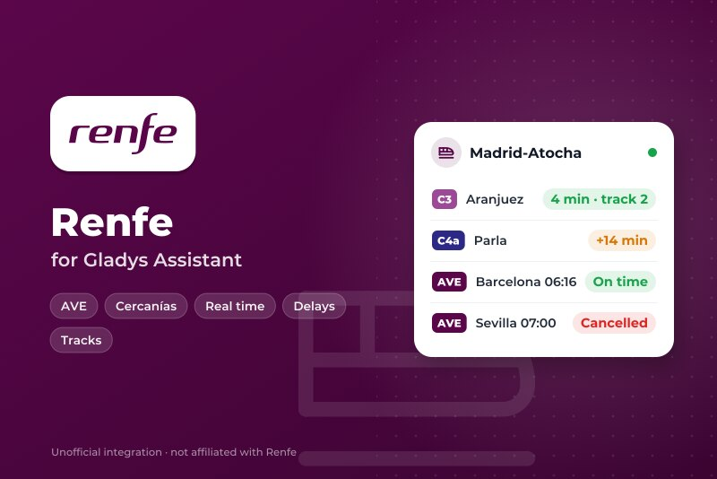
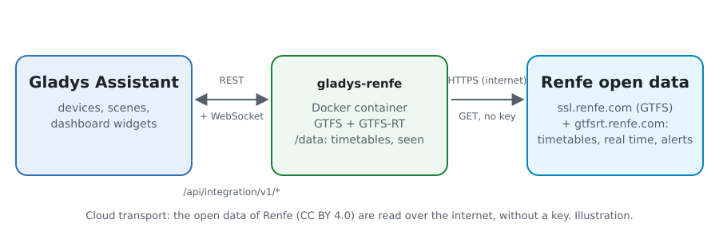
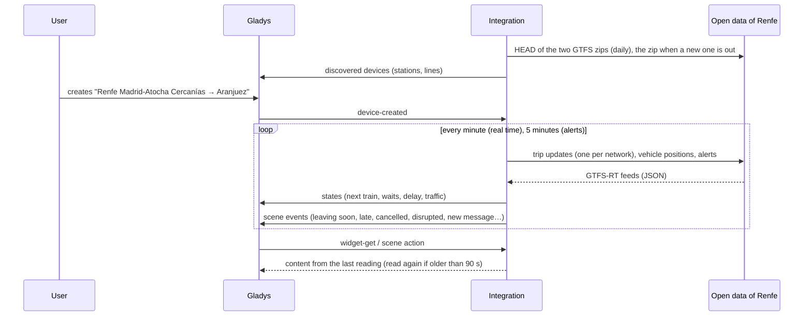
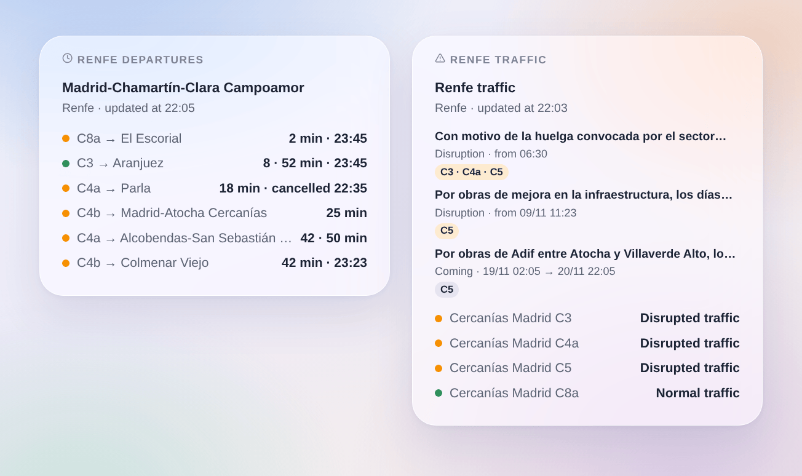

# Gladys Renfe

**English** · [Français](README.fr.md) · [Deutsch](README.de.md) · [Español](README.es.md)

[](LICENSE)
[](https://github.com/William-De71/gladys-renfe/releases)
[](https://github.com/William-De71/gladys-renfe/actions/workflows/release.yml)
[](https://gladysassistant.com)



[Gladys Assistant](https://gladysassistant.com) external integration for **Renfe**, the Spanish trains — long and medium distance (AVE, Avlo, Alvia, Intercity, Regional) and the Cercanías and Rodalies of every núcleo: the next trains at your stations, corrected in real time, with their delay, their track, their arrival at your destination and the cancelled trains, and the traffic of your Cercanías lines, with scenes and dashboard widgets. It reads the official open data of Renfe (GTFS and GTFS-RT), without an account or a key.

User documentation: [English](docs/en.md) · [Français](docs/fr.md) · [Deutsch](docs/de.md) · [Español](docs/es.md).

> Community integration, not affiliated with nor endorsed by Renfe or Adif.

## Features

- **One device per followed station** (three in the form, up to 10 more with the **Add a station** button), typed by name or code, optionally towards a **destination station** and for one **line** (a Cercanías line or a long distance product): next train, wait of the next two trains, delay of the next one, its track and its arrival time.
- **One device per followed Cercanías line** (up to six): its traffic state (normal, traffic information, disrupted, heavily disrupted) from the alerts of Renfe, and the messages under way.
- **Real time**: the estimated time and the delay once the train left its first station, the timetable otherwise (marked as such), the cancelled trains and the stations not served, the track of the Cercanías trains.
- **6 scene triggers** (including a train late by 5 to 60 minutes), **2 scene actions** and **2 dashboard widgets** (below).
- **One request per network for every followed station**: the real time every minute by default (30 s to 5 min, every 10 min at night when nothing is announced), the alerts every 5 minutes, the two timetables once a day only when they changed (kept in `/data`).
- Configuration buttons: test the connection, find a station (codes, lines), add / remove / list stations, diagnostic.
- Four languages everywhere: English, French, German, Spanish.

## How it works



```mermaid
flowchart LR
  G[Gladys Assistant] <-->|REST /api/integration/v1/* + WebSocket| I[gladys-renfe container]
  I -->|HTTPS, no key| A[ssl.renfe.com (GTFS)<br/>gtfsrt.renfe.com (GTFS-RT, JSON)]
  I --- D[(/data<br/>timetable zips, lines, stations, events seen)]
```

At start, the integration downloads the two timetables of Renfe (the long distance zip, 0.7 MB, and the Cercanías one, 15 MB) and keeps them in `/data`; the next days a HEAD request compares their size and their date (the servers of Renfe date one file a few seconds apart), and a zip is downloaded again only when Renfe published a new one. It reads the lines (`routes.txt`: the long distance products, "AVE", "Regional"; the Cercanías lines of each núcleo, the route ids "10T0007C3" of both directions gathered into "C3 Madrid") and the stations of the two files, merged on the codes of Adif ("17000" for Madrid-Chamartín-Clara Campoamor). It then resolves what you typed: "chamartin" is the station 17000, "C3" the C3 calling at your station. From the zips it extracts the calls of the followed stations over eight days (`trips.txt` and `stop_times.txt`, 272 MB once inflated for the Cercanías, are streamed, never held in memory: a reading peaks at about 170 MB and takes a few seconds). On its own timer it reads the trip updates of the networks of your stations (one JSON request per network whatever the number of stations) and the positions of the Cercanías trains (their track); Renfe announces the delay at the next station of each train, carried to your station. Every 5 minutes it reads the alerts. Each reading is compared with the previous one to fire the scene triggers.



### Transport

Cloud only (`"transports": ["cloud"]`): the catalog shows the cloud badge. The integration contacts `ssl.renfe.com` + `gtfsrt.renfe.com`. There is no local alternative, so there is no "prefer the local connection" button.

## Devices and features

| Device                       | Feature                      | Category / type              | Values                                                          |
| ---------------------------- | ---------------------------- | ---------------------------- | --------------------------------------------------------------- |
| Renfe \<station\> → \<dest\> | Next train                   | `text` / `text`              | "C3 → Aranjuez · 3 min (+2 min late) · track 2 · arr. 23:13"    |
| Renfe \<station\> → \<dest\> | Wait, wait for the following | `duration` / `integer`       | 0 … 180 min                                                     |
| Renfe \<station\> → \<dest\> | Delay of the next train      | `duration` / `integer`       | 0 … 300 min                                                     |
| Renfe Cercanías \<line\>     | Traffic                      | `text` / `text`              | "Disrupted traffic: Por obras de mejora en la infraestructura…" |
| Renfe Cercanías \<line\>     | Traffic messages under way   | `counter-sensor` / `integer` | 0 … 20                                                          |

Without any train in the next four hours, the station shows the first train of each route in the next 24 hours; the delay is published only for a train followed in real time.

## Scene triggers, actions and widgets



**Scene triggers** (once per transition; the first reading is a reference and fires nothing):

- **Departure soon**: a train of a followed station leaves in 2, 3, 5, 10, 15, 20 or 30 minutes, on its real-time estimate. Filters: station, minutes.
- **Train late**: a train of a followed station leaving within two hours is 5, 10, 15, 30 or 60 minutes late or more, once per train and threshold. Filters: station, minutes.
- **Train cancelled**: a train of a followed station leaving within two hours is cancelled or does not stop there any more. Filter: station.
- **Line disrupted**: a followed line becomes disrupted or heavily disrupted. Filter: line.
- **Back to normal**: no disruption under way on the line any more. Filter: line.
- **New traffic message**: Renfe publishes an alert about a followed line, under way or coming. Filters: line, kind (information, disruption, heavy disruption).

**Scene actions**: **next trains** of a station (line, train number, destination, wait, time, arrival, track, real time or not, delay, the following one, a sentence) and **traffic of a line** (state, messages, latest message, a sentence).

**Widgets**: **Renfe departures** (a followed station, several in one list, or any station typed in the settings) and **Renfe traffic** (the followed lines, the ones typed, or the Cercanías lines of your stations by default).

Examples:

- When **your C3 to Aranjuez leaves in 10 minutes** → light the hall lamp in green.
- When **your AVE to Barcelona is 15 minutes late** or **is cancelled** → send `{{triggerEvent.data.summary}}` to your phone.
- Every weekday at 7:30 → **read the next trains** of your station and have the `summary` spoken by the kitchen speaker.

## Requirements

- Gladys Assistant **5.3.0** or later (widgets and scene triggers of external integrations, catalog keywords and countries of Gladys 5.3). Older instances cannot install the integration.
- Nothing else: the open data of Renfe need neither an account nor a key.

## Installation

- **From the store** of Gladys (Integrations → External integrations), in one click, once indexed.
- **From the repository URL**: `https://github.com/William-De71/gladys-renfe`.
- **Developer mode**: build the image locally (`docker build -t gladys-renfe .`) and install it from Gladys.

## Configuration

| Field                    | Description                                                                              |
| ------------------------ | ---------------------------------------------------------------------------------------- |
| Station (1 to 3)         | A name as Renfe writes it, a part of it or its code: "Madrid-Atocha Cercanías", "17000". |
| Destination              | Only the trains calling there afterwards: "Aranjuez". Empty: every train leaving.        |
| Line                     | "C3", "R2N", "AVE", "Regional". Empty: every line.                                       |
| Followed lines           | Cercanías lines, up to six, with their núcleo when needed: "C3 Madrid, C1 Sevilla".      |
| Reading of the real time | 30 s, 1 min (default), 2 min or 5 min.                                                   |
| Language of the texts    | Device names, scene summaries and outputs.                                               |

Buttons: **Test the connection**, **Find a station** (code and lines of each station found), **Add a station**, **Remove a station**, **List the stations** (the stations beyond the three of the form, kept in the Gladys configuration) and **Diagnostic** (writes the stations, lines, timetables kept, last trains, errors and requests to the Logs tab).

## Usage

1. Enter one to three stations — more with **Add a station** — (with a destination and a line if you wish) and the Cercanías lines to follow, then save.
2. In the **Discover** tab, create the "Renfe …" devices.
3. Add the **Renfe departures** and **Renfe traffic** widgets to a dashboard, and build scenes with the triggers above.

## Development

```bash
npm install
npm test                       # node --test, never touches the network
npm run lint && npm run format:check
npx github:GladysAssistant/integration-store . --skip-image-check
scripts/build-cover.sh         # cover.jpg from docs/assets/cover.svg
docs/illustrations/render.sh   # docs/assets/widgets.<lang>.png
node .github/scripts/release.mjs next
```

Locally, the SDK reads `GLADYS_HOST_API_URL`, `GLADYS_INTEGRATION_TOKEN` and `GLADYS_INTEGRATION_SELECTOR`; `RENFE_API_URL`, `RENFE_GTFS_LD_URL` and `RENFE_GTFS_CER_URL` point the integration to other sources (a mock); `DEBUG=gladys-integration-sdk` shows the SDK logs and checks every widget content. The tests use real open data of Renfe, reduced (`test/fixtures/`, CC BY 4.0, the evening of 17 November 2026): the zips are built by `test/helpers/fixtures.js`. The rules of the project are in [CLAUDE.md](CLAUDE.md).

## Release process


Every merge on `main` runs the CI, then computes the version from the [Conventional Commits](https://www.conventionalcommits.org/) since the last tag: `feat` → minor, `fix` / `perf` → patch, `!` or `BREAKING CHANGE` → major (a minor below 1.0.0); `docs`, `chore`, `ci`, `test`, `style`, `refactor`, `build` alone publish nothing. The changelog section is generated, the tag pushed, the multi-architecture image built, then `main` receives the release commit, the GitHub Release is created and a last job checks the public image, the store validator and the topic.

- The pull request title becomes the squash commit, then the changelog line: write it in English, for the user (`pr-title.yml` checks it). Never edit `CHANGELOG.md` by hand.
- 1.0.0 is a decision: Actions → Release → Run workflow with `release-as: 1.0.0`. `dry-run` shows the version and the notes without publishing.
- **Protected branch**: the release pushes its commit to `main` with `GITHUB_TOKEN`. With a ruleset on `main` stricter than "no deletion, no force-push", add GitHub Actions to its bypass list (or push through a GitHub App), otherwise the publish job fails with instructions.
- After the first release, make the `ghcr.io` package public (Package settings → Change visibility), or Gladys cannot pull it.

## Troubleshooting

See [docs/en.md](docs/en.md#troubleshooting). Report issues with the versions of Gladys and of the integration, the station or line concerned, and the lines of the **Diagnostic** button.

## Contributing

Issues and pull requests are welcome. Run `npm run format:check && npm run lint && npm test` before opening a pull request, and keep every external id and stored key unchanged (see [CLAUDE.md](CLAUDE.md)).

## Security

See [SECURITY.md](SECURITY.md): report vulnerabilities privately. The integration needs no secret: it only reads public open data, and runs read-only, as a non-root user, in its container.

## Screenshots to come

The images above are illustrations, not screenshots. Real screenshots will go in `docs/assets/screenshots/` (PNG, 1280 × 800): `configuration.png`, `discovery.png`, `device.png`, `scene.png`.

## License

[Apache License 2.0](LICENSE) — see also [NOTICE](NOTICE). The timetables, the real time and the alerts are open data of Renfe (data.renfe.com) under the [Creative Commons Attribution 4.0](https://creativecommons.org/licenses/by/4.0/) licence: the widgets show the source and the time of each reading. Thanks to the Gladys documentation and SDK, and to Renfe for publishing these data in real time.
