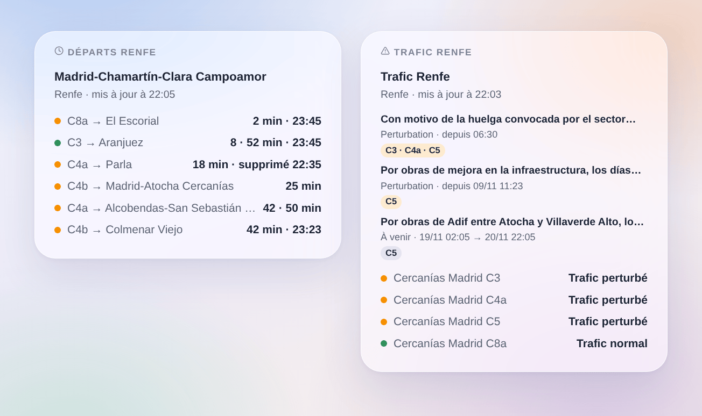

# Renfe

## Présentation

Cette intégration amène dans Gladys les trains de la **Renfe**, l’opérateur ferroviaire espagnol : les grandes lignes (AVE, Avlo, Alvia, Intercity, Regional, Avant…) et les **Cercanías** et **Rodalies** de chaque núcleo (Madrid, Barcelone, Valence, Séville, Bilbao…). Elle donne les **prochains trains, corrigés en temps réel, avec leur retard**, dans les gares que vous choisissez (trois dans le formulaire, jusqu’à 10 de plus avec un bouton), au besoin vers une **gare de destination** (avec l’heure d’arrivée) et pour une seule **ligne**. La **voie** d’un train de Cercanías est donnée dès que la Renfe l’annonce. Elle suit aussi le **trafic** de six lignes de Cercanías au plus (normal, info trafic, perturbé, très perturbé), avec les alertes de la Renfe : travaux, grèves, bus de remplacement. Chaque gare et chaque ligne devient un appareil à afficher sur un tableau de bord et à utiliser dans les scènes.

Les données viennent de l’**open data officiel de la Renfe** (`data.renfe.com`), sous licence CC BY 4.0 : ni compte ni clé. Les deux **horaires** (GTFS des grandes lignes et des Cercanías) ne sont téléchargés que quand la Renfe en publie de nouveaux, et sont gardés par l’intégration. Le **temps réel** (GTFS-RT) est lu en **une requête par réseau pour toutes les gares suivies**, chaque minute par défaut (toutes les 10 minutes tant qu’aucune gare n’annonce rien dans la demi-heure, la nuit). Les alertes sont lues toutes les 5 minutes.

Un train est **suivi en temps réel** dès qu’il a quitté sa gare d’origine : son heure estimée et son retard sont donnés. Avant, c’est l’**horaire théorique**, marqué « (théorique) ». Les **trains supprimés** et les **gares non desservies** sont affichés.

C’est une intégration **cloud** : elle contacte `ssl.renfe.com` (horaires) et `gtfsrt.renfe.com` (temps réel). Rien d’autre ne sort de votre réseau.

## Prérequis

- Gladys Assistant 5.3.0 ou plus récent.
- Rien d’autre : l’open data de la Renfe ne demande ni compte ni clé.

## Configuration

| Champ                 | Quoi saisir                                                                                                                       |
| --------------------- | --------------------------------------------------------------------------------------------------------------------------------- |
| Gare 1, 2, 3          | La gare telle que la Renfe l’écrit : « Madrid-Atocha Cercanías », « Aranjuez », une partie (« Chamartín ») ou son code.           |
| Destination           | Seulement les trains qui desservent ensuite cette gare, avec leur arrivée. Vide : tous les trains au départ.                      |
| Ligne                 | Seulement cette ligne : une ligne de Cercanías (« C3 », « R2N ») ou un produit grandes lignes (« AVE », « Avlo »). Vide : toutes. |
| Lignes suivies        | Les lignes de Cercanías dont vous suivez le trafic, six au plus : « C3 Madrid, R2N ».                                             |
| Lecture du temps réel | Toutes les 30 secondes, minutes, 2 minutes ou 5 minutes.                                                                          |
| Langue des textes     | Noms des appareils, résumés et sorties des scènes. Les noms de gares et les messages de trafic restent en espagnol.               |

Une gare est une gare d’Adif, desservie aussi bien par les grandes lignes que par les Cercanías : « Madrid-Atocha Cercanías » donne les C2 à C10 et les trains régionaux qui s’y arrêtent ; les trains à grande vitesse partent de « Madrid-Puerta de Atocha-Almudena Grandes », une autre gare. Le bouton **Chercher une gare** donne les gares contenant quelques mots, avec leur code et leurs lignes (« Madrid-Atocha Cercanías [18000] → Regional, C3 Madrid… »). Quelques mots suffisent quand une seule gare les contient (« chamartin »).

Une ligne de Cercanías s’écrit avec son núcleo quand son nom existe ailleurs (« C1 » circule dans dix núcleos) : « C3 Madrid », « C1 Sevilla », « Rodalies R2 » ; seule, c’est celle qui dessert vos gares. **Tester la connexion** redemande les horaires et lit aussitôt chaque gare et chaque ligne.

Plus de gares que les trois du formulaire (domicile, travail, un trajet de la semaine…) : **Ajouter une gare** prend les mêmes trois champs — gare, destination, ligne — et suit jusqu’à 10 gares de plus. **Lister les gares** montre toutes les gares suivies, numérotées ; **Retirer une gare** prend ce numéro (ou le nom). Les gares ajoutées sont gardées dans la configuration de Gladys et suivent donc ses sauvegardes.

Les horaires des Cercanías forment un gros fichier : la première lecture, et celle de chaque nouveau fichier, prend 10 à 30 secondes.

## Utilisation

### Appareils

Dans l’onglet **Découvrir**, créez les appareils voulus :

- **Renfe \<gare\> → \<destination\>** : le prochain train en texte (« C3 → Aranjuez · 3 min (+2 min de retard) · voie 2 · arr. 23:13 », « AVE 3063 → Barcelona-Sants · 06:27 (théorique) »), l’attente du prochain train et du suivant (minutes), et le retard du prochain (minutes, publié seulement quand il est suivi en temps réel) ;
- **Renfe Cercanías Madrid C3**, **Renfe Rodalies R2N**… : le trafic en texte (« Trafic perturbé : Por obras de mejora… ») et le nombre de messages de trafic en cours.

Sans train dans les quatre heures, l’appareil montre le premier de chaque trajet des 24 heures suivantes.

### Trafic

La Renfe publie des **alertes** pour les Cercanías : un texte en espagnol, les lignes concernées et leurs périodes. L’état d’une ligne vient de sa plus lourde alerte en cours : **très perturbé** pour une interruption ou un service de remplacement par autocar, **perturbé** pour des travaux, une grève, des retards, des fréquences modifiées, **info trafic** sinon (ascenseurs en panne, titres de transport) ; **normal** sans alerte. Une alerte qui commence dans les trois jours est affichée « à venir ». Les alertes qui ne visent qu’une gare (un ascenseur, une entrée) sont écartées. Les grandes lignes n’ont pas d’alertes : leurs retards et suppressions sont ceux des trains.

### Widgets du tableau de bord

- **Départs Renfe** : les prochains trains d’une gare, en compact. Une rangée par ligne et destination, avec ses prochains trains à la suite (« 8 · 52 min »). Un train supprimé est affiché (« supprimé 22:35 ») et passe la rangée en orange, comme un retard de 5 minutes ou plus. Le réglage **Trajets affichés** fixe le nombre de rangées. Choisissez une gare suivie, ou saisissez n’importe quelle gare (et une ligne) dans les réglages du widget. Avec **Plusieurs gares**, un widget montre plusieurs appareils gares : ceux d’une même gare sont réunis sous son nom ; pour des gares différentes, chacune ouvre sur une rangée à elle.
- **Trafic Renfe** : l’état de chaque ligne, puis les alertes en cours et celles des trois jours à venir, avec leur période. Touchez une carte pour le texte complet. Les lignes suivies, celles saisies dans les réglages, ou les lignes de Cercanías de vos gares si vous n’en suivez aucune.

### Scènes

Déclencheurs, une fois par changement (la première lecture n’est qu’une référence) :

- **Renfe : départ imminent** : un train d’une gare suivie part dans 2, 3, 5, 10, 15, 20 ou 30 minutes, compté sur son estimation en temps réel.
- **Renfe : train en retard** : un train d’une gare suivie partant dans les deux heures a 5, 10, 15, 30 ou 60 minutes de retard ou plus, une fois par train et par seuil.
- **Renfe : train supprimé** : un train d’une gare suivie partant dans les deux heures est supprimé, ou ne s’y arrête plus.
- **Renfe : ligne perturbée** : une ligne suivie devient perturbée ou très perturbée.
- **Renfe : fin de perturbation** : plus aucune perturbation en cours sur la ligne.
- **Renfe : nouveau message trafic** : la Renfe publie une alerte sur une ligne suivie, en cours ou à venir.

Chacun donne une phrase toute prête, `{{triggerEvent.data.summary}}`, et ses valeurs (ligne, numéro du train, destination, heure, retard, voie, titre, texte, début et fin…). Les actions **Renfe : prochains trains** et **Renfe : trafic d’une ligne** renvoient le même genre de valeurs, à mettre dans un message ou à tester dans une condition.

Exemples :

- Quand votre C3 vers Aranjuez part dans 10 minutes → passer la lampe de l’entrée au vert.
- Quand votre AVE pour Barcelone a 15 minutes de retard ou est supprimé → envoyer le résumé sur votre téléphone avant de partir.
- Chaque jour de semaine à 7 h 30 → lire les prochains trains de votre gare et les faire annoncer par l’enceinte de la cuisine.

### Transport

Cloud uniquement : les données viennent d’internet. Les horaires quand la Renfe en publie de nouveaux, le temps réel des réseaux de vos gares en une requête chacun, les alertes toutes les 5 minutes.

## Dépannage

- **« Inconnu ou ambigu »** : utilisez **Chercher une gare**, puis copiez le nom exact ou le code entre crochets ; pour une ligne de Cercanías, ajoutez son núcleo (« C1 Sevilla »).
- **« (théorique) » après un train** : il n’a pas encore quitté sa gare d’origine, ou la Renfe ne le suit pas ; l’heure est celle de l’horaire.
- **Aucun train vers la destination** : la destination doit être une gare desservie après la vôtre ; vérifiez le nom avec **Chercher une gare**, ou videz la destination pour voir tous les trains.
- **Une grève, beaucoup de trains supprimés** : la Renfe annonce les suppressions du jour ; elles sont affichées pour les six heures à venir, jamais pour les jours suivants.
- **« L’open data de Renfe ne répond pas »** : l’intégration réessaie à chaque lecture ; en attendant, les trains viennent des horaires gardés, et une lecture de moins de 3 minutes remplace une lecture refusée.
- **Pour signaler un problème** : appuyez sur **Diagnostic**, puis copiez les lignes commençant par « Renfe diagnostic » de l’onglet Journaux dans une issue GitHub ou une réponse sur le forum, avec les versions de Gladys et de l’intégration.
